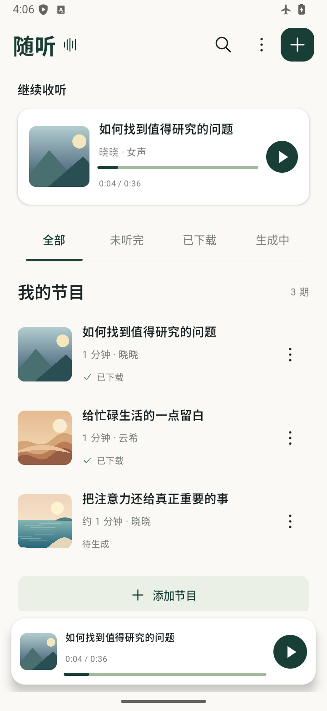
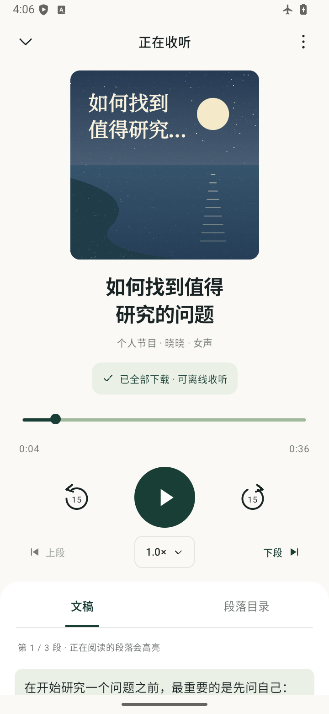
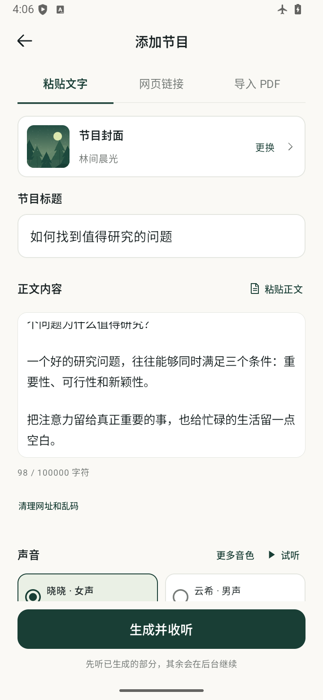

# 随听 SuiTing

把文字、文章和 PDF，变成自己的播客。Android 8.0 及以上可用。

Turn text, web articles and PDFs into your personal podcast. Built for Android.

**[下载 Android APK](https://github.com/hallowichkrysiak532-ship-it/SuiTing/releases/latest)** · [更新日志](CHANGELOG.md) · [反馈问题](https://github.com/hallowichkrysiak532-ship-it/SuiTing/issues/new?template=bug_report.yml)

无需电脑、服务器或开发环境，安装 APK 后即可使用。生成音频时需要联网，保存后可离线收听。

- 粘贴文字、提取公众号或网页正文、导入文字型 PDF。
- 多种 Edge 音色和手机系统声音，按段生成并保存在本机。
- 暂停、跳段、倍速、后台播放，自动保存收听进度。
- 文稿清理、草稿保存、断点续生成和节目删除。

当前版本 **0.2.1**。每期最多 10 万字符，音频总量上限约 512 MB；PDF 最多 20 MiB、300 页，扫描件暂不支持 OCR。

## 界面预览

| 节目库 | 收听页 | 添加节目 |
| --- | --- | --- |
|  |  |  |

截图使用示例节目。支持原文封面与 [8 款可切换的风景插画](docs/images/covers.png)，示例内容不随安装包预置。

## 下载与安装

1. 打开 [最新版本](https://github.com/hallowichkrysiak532-ship-it/SuiTing/releases/latest)，在 **Assets** 中下载 `.apk` 文件；`Source code` 是源代码，不能直接安装。
2. 在 Android 手机上打开 APK，按系统提示允许当前浏览器或文件管理器安装应用。
3. 首次添加节目后，如需锁屏或后台持续生成，请允许应用通知；部分手机还需要在系统电池设置中允许后台运行。

已有随听的用户可以覆盖安装，节目和进度会保留。**升级前不要卸载旧版**，卸载会删除本机音频和正文。当前提供测试版 APK，使用同一签名持续更新；每次发布会附上 `SHA256SUMS.txt`，便于校验文件。

欢迎通过项目链接分享给朋友；遇到问题请在 [Issues](https://github.com/hallowichkrysiak532-ship-it/SuiTing/issues) 中提供应用版本、设备型号和复现步骤，反馈截图前请遮住个人信息。

## 使用

添加节目 → 导入正文 → 选择声音 → 创建并生成。

新版采用深绿与暖白界面：节目库提供继续收听、标题搜索、状态筛选和底部迷你播放器；收听页展示独立封面、全篇播放与下载进度、文稿和段落目录；添加节目为独立页面，支持文字、网页与 PDF 导入、音色选择和分段预览，返回时保留草稿。默认风景封面在手机本地绘制，无需下载图片。尚未生成部分的时长会标为预计值，进度拖动只能到已下载位置。

从网页提取文章时，会一并读取网站提供的原文封面（Open Graph、Twitter 图片元数据及公众号封面字段）。成功加载后会保存缩略图，离线仍可显示。未提供封面、图片受限或暂时加载失败时，显示本地风景插画；纯文字、PDF 和旧节目默认使用风景封面。添加页点“节目封面”，或节目菜单点“更换封面”，可选择原文图与八款风景，选择会随节目和草稿保存。图片最多读取 4 MB、缩小至最长边 768 像素，持久缓存上限约 32 MB，独立于音频生成任务。桌面图标已适配 Android 自适应形状与 Android 13 主题图标。

网页白屏时可在“更多”中选择“兼容重试”。已生成音频可离线播放，日常使用不需要电脑或服务器；卸载应用会删除节目。

音频生成时可以切到后台或锁屏，通知栏显示进度并可停止。Edge 最多四路并发，会合并相邻短段以减少请求；段落目录、上下段、段内进度和断点续听均保留。服务未返回可靠的段落时间戳时，自动改用逐段请求。系统声音逐段生成。新段落下载并验证后会自动加入播放列表；听到下载末尾时等待下一段并自动续播，主动暂停后不会自动播放。收听页使用系统返回手势会回到节目库。

此版本已移除本地模型及运行库，升级后首次启动会清理旧模型文件。已经保存的本地音频仍可播放，未完成的历史节目继续生成时会使用默认 Edge 声音，保留已保存的段落和进度。

Edge 生成需要联网，正文会发送至微软语音服务。此功能使用第三方客户端协议，可用性可能变化；系统声音的联网需求由手机引擎决定。

## 开发

使用 Android SDK 36、Build Tools 35.0.0、JDK 17 或更新版本、Gradle 8.13。设置 `JAVA_HOME` 和 `ANDROID_HOME`，或通过 Android Studio 配置 SDK。

Windows 推荐在项目目录运行：

```powershell
.\build.ps1
# 依赖齐全后离线构建
.\build.ps1 -Offline
```

脚本运行本地测试、静态检查并生成 APK，将缓存、临时文件和签名密钥放在项目的 `.tooling/` 中，安装包输出到 `dist/`。可通过不入库的 `.tooling/build-local.psd1` 配置 `JavaHome`、`AndroidSdk`、`GradleExecutable` 和 `ReadOnlyDependencyCache`，复用已有环境。

也可使用标准 Gradle Wrapper：

```sh
./gradlew testDebugUnitTest lintDebug assembleDebug
```

标准构建输出为 `app/build/outputs/apk/debug/app-debug.apk`。首次构建会下载缺失的 Gradle 或依赖；本机辅助脚本可指定已有 Gradle，避免重复下载。

APK 通过 [GitHub Releases](https://github.com/hallowichkrysiak532-ship-it/SuiTing/releases) 提供；Git 源码目录不保存安装包、依赖缓存、本机配置或签名密钥。请在本地妥善保留 `.tooling/android-user-home/debug.keystore`；丢失密钥后，新生成的 APK 通常无法覆盖原安装。其他机器构建的 debug APK 也不会自动使用同一签名。

## 依赖与许可

使用 AndroidX、Media3、OkHttp、jsoup、PDFBox-Android 和 Bouncy Castle。Edge 令牌算法改编自 [rany2/edge-tts](https://github.com/rany2/edge-tts)，采用 LGPL-3.0，参考源码见 `tools/reference_edge_drm.py`。

第三方许可及 NOTICE 见 `app/src/main/assets/third-party/`，随安装包分发；根目录另保留 Edge 相关许可全文。
